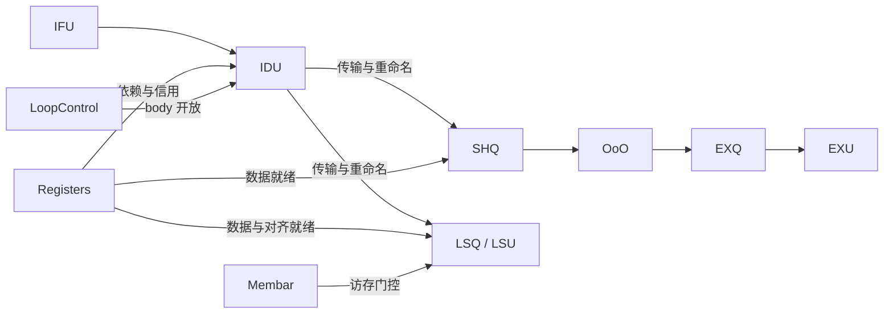

# Python 执行模型

`CoreVfCostModel.run_vf_info()` 接收通过 API 校验的 Canonical 程序，解析参数、准备
动态指令并创建 `Engine`。Engine 按 cycle 更新各组件，直到指令流、传输和执行状态排空。

## 程序准备

`prepare_program()` 依次调用 Core lowering、静态布局和动态展开。
`CoreLoweringPass` 把 Canonical dataclass 转成 Core 内部字典，保留指令、值声明、
存储对象、访存及循环信息。`ValueStorageLookup` 根据显式声明查询存储类别。
静态布局记录 PC、loop 层级和顶层 block；`DynamicExpander` 根据 count/unroll 生成
`DynamicInstruction`，解析动态值实例和最后使用位置。

动态指令身份包括 `inst_id`、`static_instruction_id`、`stream_seq` 和 `iteration_path`。
`Registers.rename()` 为可重命名的输入输出绑定物理资源，生成运行期 `Uop`。
Uop 保存 Profile、物理源和目的、状态、开始/完成时间以及访存与对齐依赖。

## 组件流转

IFU 保存准备好的动态指令 deque。Engine 根据 IDU 窗口空间取出指令，Membar 节点
交给控制器，普通指令进入 IDU。取指路径采用简化指令流模型，独立取指端口、I-cache
和分支预测时序超出其建模范围。

IDU 从队头顺序分发，检查 startup、循环开放、分发宽度、vector/predicate 目的信用、
SHQ/LSQ 容量和地址状态。队头受阻时结束本周期选择。`Engine.reservation()` 为传输中的
指令预留目的资源、队列位置和共用信用，`admit()` 完成实际重命名与入队。

COMPUTE 进入 SHQ，OoO 按数据就绪、合法端口、FU 轮转及 EXQ 容量分发。
EXQ 为每端口维护 FU 队列，从满足接收延迟和 EXU 条件的队首选择指令。
EXU 检查端口、成对 II 和在执行容量，记录开始并在 latency 到期时完成。
关闭 EXQ 队列模型时，`OoO.issue_direct_from_shq()` 直接选择 SHQ→EXU 指令。

LOAD 和 STORE 进入 LSQ，由 LSU 仲裁。STORE 同时占用 SHQ 共用信用。
访存约束见[访存模型](lsu_model.md)。

## 单周期阶段

`Engine.run()` 和 `backend_step()` 按以下顺序推进：

1. 发布寄存器和 SHQ 的可见信用。
2. 接收传输到达的指令，重命名并入队。
3. 用 IFU 填充 IDU 窗口并接收 Membar。
4. 更新屏障阶段，计算 IDU 的分发预算。
5. 分发 IDU 指令，放入传输队列或直接后端接收。
6. 处理 SHQ 和源寄存器释放事件。
7. 处理 EXU/LSU 完成事件并更新生产者、资源和排空状态。
8. 更新依赖就绪，执行第一轮 LSU 仲裁。
9. 执行 OoO→EXQ 和 EXQ→EXU 流转，或直接计算发射。
10. 使用同一份剩余 UB 预算执行第二轮 LSU 仲裁。

阶段顺序决定零延迟资源的同周期可见性、forwarding 和屏障边界。

## 循环控制

`LoopControl` 记录各顶层 block 和嵌套循环的 VLOOP 起点、body 开放时间、最后分发
时间及迭代步距。`can_dispatch()` 查询当前指令所处循环的开放条件；
`notify_dispatch()` 更新反馈并触发后续 block 或循环。

动态展开已经确定指令顺序和迭代身份，LoopControl 为这些指令施加运行时开放门槛。
循环规则参考 count、嵌套关系、unroll 和最后分发位置。最内层 unroll 使用按
load/compute/store 分组的展开顺序；非最内层 unroll 和不能整除的次数会被能力检查拒绝。

## 数据就绪与完成

普通寄存器依赖由 producer 的开始周期加 forwarding 决定。队列模型的计算消费者
使用 `max(0, forwarding-1)` 更新 SHQ ready，随后还受 EXQ 接收延迟约束。
LSU 查询普通源依赖、对齐状态和屏障，再施加端口与 UB 预算。

Engine 的 `active_uops` 登记尚未完成的指令，完成时按事件更新状态。
排空条件覆盖 IFU、IDU、传输、执行中指令和 Membar；尾部屏障的 retire 参与结果。
`cycles_executed` 为排空时的 cycle，`vf_end_cycle` 为最后指令完成或屏障退休的最大
cycle 加 VF drain。达到 `params.max_cycles` 时仍未排空会抛出异常。
