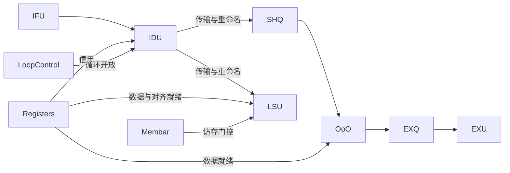

# 执行模型

`native/core/simulator.*::CoreVfCostModel` 接收经过 API 校验的 `CanonicalVfInfo`，应用 VF 配置覆盖，调用 `prepareProgram()` 并创建 `Engine`。Engine 按 cycle 推进组件，直到指令流、传输、执行状态及屏障排空。

## 程序准备

`execution/prepare.*` 检查执行能力并准备内部 value 表。`execution/expansion.*` 展开循环，构造 `DynamicInst`，解析动态定义身份、最后使用信息及循环边界。静态布局数量 `linearInstCount` 包含循环首尾控制条目。

`Registers::rename()` 为动态指令绑定物理源和目的，生成共享的 `Uop`。Uop 引用本次运行 ParamDB 持有的只读 `InstructionProfile`，并保存状态、时间和访存/对齐依赖。ParamDB 的生命周期覆盖组件运行及结果写出。

## 组件流转

IFU 保存准备好的指令流。IDU 按序分派，检查循环开放、分发宽度、寄存器和队列信用及地址状态。Engine 为传输中的指令预留资源，到达后完成重命名与入队。

COMPUTE 进入 SHQ；OoO 根据就绪状态、合法端口、FU 策略和 EXQ 容量选择指令。EXQ 维护每端口的 FU 队列；EXU 检查端口、II 和在执行容量，发布开始并在 latency 到期时完成。直接发射场景使用 SHQ→EXU 路径。

LOAD/STORE 进入 LSU，受依赖、屏障、端口和共享 UB 预算约束。STORE 同时占用 SHQ 共用信用。各组件持有自己的队列与状态，Engine 组织跨组件时序。

## 周期阶段与控制

单周期依次处理可见信用、传输接收、IDU 填充、屏障更新和有序分派；随后处理源/SHQ 信用释放、执行完成和依赖就绪，再进行 LSU、OoO 和 EXU 仲裁。LSU 两轮仲裁共享当周期的端口、事务槽和字节预算。

`execution/loop_control.*` 记录 VLOOP 起点、body 开放时间、迭代步距与分派反馈。展开后的指令保留迭代身份，循环控制器在运行时施加开放门槛。最内层 unroll 按 load/compute/store 分组；不支持的展开形式由执行准备拒绝。

`execution/membar.*` 根据动态指令顺序管理屏障，向 LSU 提供访问门控。尾部屏障退休参与 VF 排空。

`cyclesExecuted` 为执行排空周期，`vfEndCycle` 为最后完成或屏障退休周期加 ISA drain cost。达到周期上限仍未排空时抛出异常。
